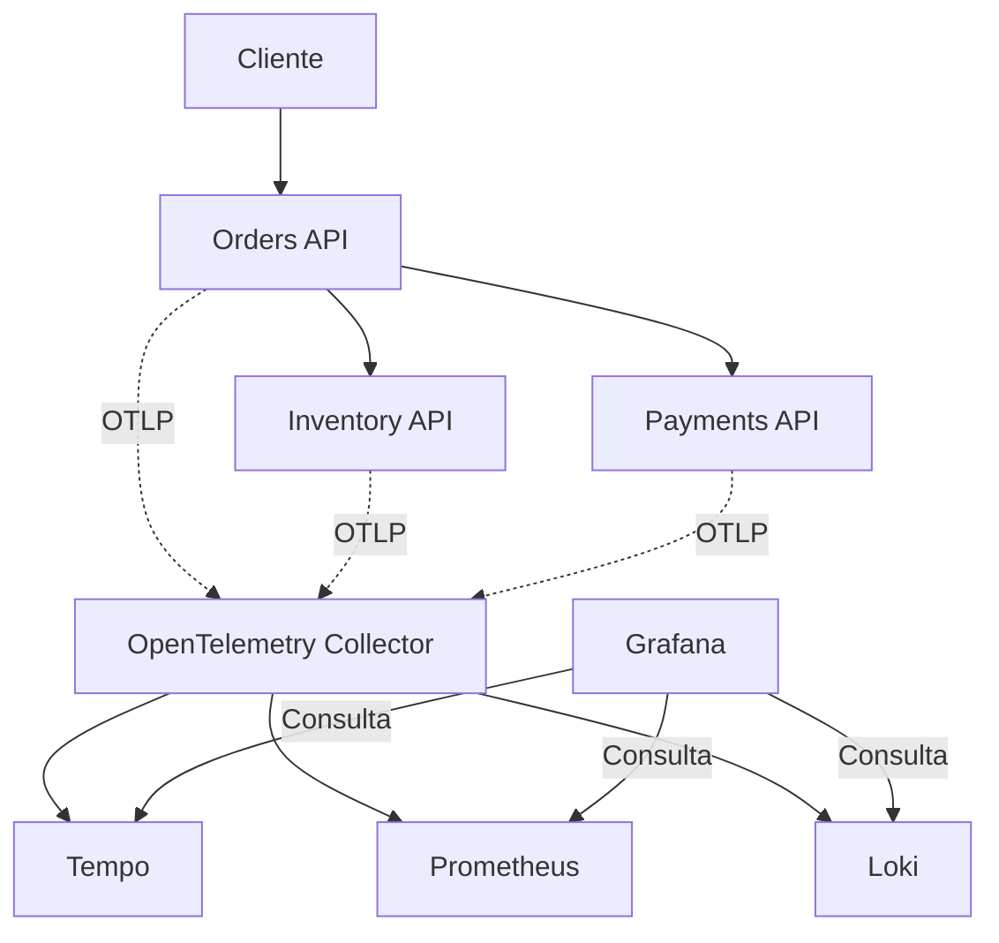

# Observabilidad de microservicios con .NET 10 y Kubernetes

Laboratorio para investigar latencia y errores en una arquitectura distribuida mediante **OpenTelemetry, Prometheus, Tempo, Loki y Grafana**. Incluye tres APIs .NET 10 y manifiestos para ejecutarlas en Kubernetes local con **kind sobre Docker Desktop, desde Windows y PowerShell**.

El objetivo es responder con evidencia:

| Pregunta durante un incidente | Herramienta |
| --- | --- |
| ¿Las solicitudes están tardando más o fallando? | Prometheus: métricas agregadas |
| ¿En qué servicio u operación aparece la demora o el error? | Tempo: trazas distribuidas |
| ¿Qué registró ese servicio durante la solicitud? | Loki: logs correlacionados por trace ID |
| ¿Dónde consultar las tres señales? | Grafana |

Es una demostración local: simula inventario y pagos, sin cobros reales, base de datos ni reserva de stock. La configuración no está diseñada para desplegarse directamente en producción.

## Arquitectura

Orders recibe la solicitud, consulta Inventory y después llama a Payments. Las llamadas son secuenciales. Cada API exporta telemetría por OTLP/gRPC al Collector.



Para simplificar la instalación, `grafana/otel-lgtm:latest` ejecuta el Collector y los backends de observabilidad en un único contenedor preconfigurado. Las tres APIs sí tienen Deployments independientes. El diagrama representa componentes lógicos; no implica un pod por backend.

OpenTelemetry genera y exporta las señales desde las APIs. El Collector las recibe, procesa y exporta; Tempo, Prometheus y Loki las almacenan. Grafana las consulta. En otras configuraciones, Prometheus puede recoger métricas mediante scraping del Collector; no debe interpretarse el diagrama como una obligación de usar push.

## Estructura de la solución

```text
ObservabilityLab/
├── Orders.Api/
│   ├── Program.cs              # Entrada de órdenes, llamadas HTTP y métricas de negocio
│   └── TelemetryExtensions.cs  # Instrumentación y exportación OTLP
├── Inventory.Api/
│   ├── Program.cs              # Consulta simulada de inventario
│   └── TelemetryExtensions.cs  # Instrumentación y exportación OTLP
├── Payments.Api/
│   ├── Program.cs              # Autorización simulada y escenarios de latencia/error
│   └── TelemetryExtensions.cs  # Instrumentación y exportación OTLP
├── Dockerfile                 # Compilación de cada proyecto con el argumento PROJECT
├── k8s/
│   ├── lgtm.yaml               # Deployment y Service de observabilidad
│   ├── orders.yaml             # Deployment y Service de Orders
│   ├── inventory.yaml          # Deployment y Service de Inventory
│   └── payments.yaml           # Deployment y Service de Payments
├── scripts/
│   └── scenarios/
│       ├── normal-order.ps1     # Prueba una orden normal y muestra su respuesta
│       ├── slow-order.ps1       # Prueba la latencia simulada de Payments
│       ├── payment-error.ps1    # Prueba el error de pago y muestra el HTTP 502
│       └── generate-traffic.ps1 # Genera tráfico con los tres escenarios
└── ObservabilityLab.sln        # Solución .NET
```

## 1. Requisitos

1. Windows compatible con Docker Desktop, con virtualización habilitada y backend WSL 2.
2. Docker Desktop en ejecución con contenedores Linux.
3. kind y kubectl.
4. Git para clonar el repositorio.
5. Conexión a Internet para descargar imágenes y paquetes.
6. SDK de .NET 10, opcional para editar o compilar fuera de Docker.

## 2. Obtener el código

Con Git instalado, abre PowerShell en la carpeta donde quieras guardar el laboratorio. Luego ejecuta:

```powershell
git clone https://github.com/MichaelHorta/observability-lab.git observability-lab
cd observability-lab
Get-ChildItem
```

## 3. Construir las imágenes

Ejecuta cada comando y continúa solo si finaliza correctamente:

```powershell
docker build --build-arg PROJECT=Orders.Api -t orders-api:lab .
docker build --build-arg PROJECT=Inventory.Api -t inventory-api:lab .
docker build --build-arg PROJECT=Payments.Api -t payments-api:lab .
```

El punto final es el contexto de construcción. `.dockerignore` excluye `bin/` y `obj/`; la aplicación se recompila dentro de Docker. El tag fijo `:lab` se reutiliza durante el desarrollo.

## 4. Crear Kubernetes local

```powershell
kind create cluster --name observability-lab
kubectl config use-context kind-observability-lab
kubectl config current-context
kubectl create namespace observability-lab
```

## 5. Cargar las imágenes en kind

```powershell
kind load docker-image orders-api:lab --name observability-lab
kind load docker-image inventory-api:lab --name observability-lab
kind load docker-image payments-api:lab --name observability-lab
```

El almacenamiento de imágenes de Docker y el del nodo Kubernetes son distintos. El mensaje `not yet present on node ... loading` es informativo, no un error.

Los manifiestos de las APIs utilizan `imagePullPolicy: Never`: las imágenes deben estar cargadas antes de desplegar. LGTM se descarga desde su registro y no utiliza esa política.

## 6. Desplegar y verificar

```powershell
kubectl apply -f ./k8s/

kubectl rollout status deployment/lgtm -n observability-lab --timeout=300s
kubectl rollout status deployment/inventory -n observability-lab --timeout=120s
kubectl rollout status deployment/payments -n observability-lab --timeout=120s
kubectl rollout status deployment/orders -n observability-lab --timeout=120s

kubectl get pods -n observability-lab
kubectl get services -n observability-lab
```

Espera un pod `1/1 Running` por Deployment. Las APIs tienen una sonda de readiness en `/health`. LGTM no define una sonda en este manifiesto: que el pod figure listo no garantiza que todos sus procesos internos hayan terminado de iniciar. Si Grafana aún no responde, revisa sus logs y espera a que termine la inicialización.

Configuración de las APIs:

| Variable | Valor |
| --- | --- |
| `OTEL_SERVICE_NAME` | `orders-api`, `inventory-api` o `payments-api` |
| `OTEL_EXPORTER_OTLP_ENDPOINT` | `http://lgtm:4317` |
| `OTEL_EXPORTER_OTLP_PROTOCOL` | `grpc` |
| `OTEL_METRIC_EXPORT_INTERVAL` | `5000` milisegundos |
| `INVENTORY_URL` | `http://inventory:8080` |
| `PAYMENTS_URL` | `http://payments:8080` |

Los nombres de Service se resuelven mediante DNS dentro del namespace. `localhost` dentro de un pod apunta a ese pod, no a otro microservicio ni a tu PC.

## 7. Abrir Orders y Grafana

En una terminal, deja ejecutándose:

```powershell
kubectl --context kind-observability-lab port-forward -n observability-lab service/orders 8080:8080
```

En otra terminal:

```powershell
kubectl --context kind-observability-lab port-forward -n observability-lab service/lgtm 3000:3000
```

Abre [Grafana](http://localhost:3000). Si solicita autenticación, el bundle de desarrollo documenta usuario `admin` y contraseña `admin`. Las fuentes de datos vienen preconfiguradas.

Mantén ambas terminales abiertas y usa una tercera para las pruebas. Para detener cada port-forward, pulsa Ctrl+C.

## 8. Probar los escenarios

Ejecuta los scripts desde la raíz del repositorio en **PowerShell 7 (`pwsh`)**, con el port-forward de Orders activo. Todos aceptan `-OrdersUri` para usar otra URL; el valor predeterminado es `http://localhost:8080/orders`.

### Orden normal

Script: [normal-order.ps1](scripts/scenarios/normal-order.ps1).

```powershell
./scripts/scenarios/normal-order.ps1
```

Espera HTTP 200, `status: completed`, un `orderId` y un `traceId`. Guarda este último para buscar exactamente esa solicitud en Tempo y Loki.

### Order lenta

Script: [slow-order.ps1](scripts/scenarios/slow-order.ps1).

```powershell
./scripts/scenarios/slow-order.ps1
```

Payments simula una espera de 2 segundos. La duración total incluye además Inventory, red y ejecución: no será exactamente 2 segundos.

### Error de pago

El script [payment-error.ps1](scripts/scenarios/payment-error.ps1) conserva el cuerpo y muestra el status del HTTP 502 esperado:

```powershell
./scripts/scenarios/payment-error.ps1
```

| Escenario | Inventory | Payments | Respuesta de Orders |
| --- | --- | --- | --- |
| `normal` | Espera simulada de 80 ms | Espera de 120 ms, HTTP 200 | HTTP 200, `completed` |
| `slow` | Espera simulada de 80 ms | Espera de 2000 ms, HTTP 200 | HTTP 200, `completed` |
| `fail` | Espera simulada de 80 ms | Espera de 120 ms, HTTP 503 | HTTP 502, `failed` |

El 502 del escenario `fail` es intencional. Un 502 para `normal` requiere investigación. Orders también limita cada llamada HTTP a 5 segundos. Un escenario diferente de los tres admitidos devuelve HTTP 400.

### Generar tráfico

Script: [generate-traffic.ps1](scripts/scenarios/generate-traffic.ps1). Envía 180 solicitudes alternando los tres escenarios, con una pausa de un segundo entre solicitudes.

```powershell
./scripts/scenarios/generate-traffic.ps1
```

El generador envía solicitudes secuenciales; sirve para explorar señales, no como benchmark de capacidad. Los errores de conexión siguen interrumpiendo la solicitud y deben investigarse.

## 9. Investigar con Grafana

Selecciona un rango que incluya las pruebas, por ejemplo **últimos 15 minutos**, y actualiza los resultados. La exportación se realiza de forma asíncrona: puede haber demora antes de visualizar datos.

### Tempo: seguir una solicitud

En **Explore**, selecciona Tempo y busca el `traceId` obtenido. También puedes usar TraceQL:

```traceql
{ resource.service.name = "orders-api" }
```

Spans lentos de Payments:

```traceql
{ resource.service.name = "payments-api" && duration > 1s }
```

Spans con estado de error:

```traceql
{ status = error }
```

La traza contiene spans HTTP automáticos y spans de negocio `order.create`, `inventory.check` y `payment.authorize`. HttpClient propaga el contexto mediante `traceparent`: cada operación tiene su span ID y todas comparten el trace ID.

En `slow`, la línea de tiempo permite localizar la espera en Payments. En `fail`, permite observar el 503 de Payments y el 502 de Orders. Una traza orienta la investigación; por sí sola no demuestra todas las causas internas de una dependencia.

### Loki: leer los logs de la solicitud

En **Explore**, selecciona Loki:

```logql
{service_name=~"orders-api|inventory-api|payments-api"}
```

Errores simulados del proveedor:

```logql
{service_name="payments-api"} |= "Payment provider unavailable"
```

Logs asociados a una traza; sustituye el valor entre comillas:

```logql
{service_name=~"orders-api|inventory-api|payments-api"} | trace_id = "PEGA_AQUI_EL_TRACE_ID"
```

Expande un registro para inspeccionar sus metadatos. Con ingestión OTLP nativa, `service.name` se normaliza a `service_name`, y el trace ID se consulta como metadato estructurado. No necesitas `| json` para estos registros. Los logs emitidos fuera de una actividad pueden no tener trace ID.

La navegación automática con enlaces entre trazas y logs depende de la configuración de las fuentes de datos. La búsqueda manual por trace ID no requiere esos enlaces.

### Prometheus: medir el comportamiento agregado

En **Explore**, selecciona Prometheus. El código de Orders define:

| Instrumento .NET | Propósito |
| --- | --- |
| `shop.orders.completed` | Intentos terminados, con `outcome=success` o `failed` |
| `shop.order.duration` | Histograma de duración en segundos, por resultado |

Aunque el contador se llame `completed`, incluye intentos fallidos. Los escenarios rechazados con HTTP 400 quedan fuera porque se validan antes del bloque que registra estas métricas.

Con la traducción estándar de nombres a Prometheus:

```promql
shop_orders_completed_total
```

Órdenes por segundo, separadas por resultado:

```promql
sum by (outcome) (rate(shop_orders_completed_total[5m]))
```

Porcentaje de intentos fallidos:

```promql
100 * sum(rate(shop_orders_completed_total{outcome="failed"}[5m]))
    / sum(rate(shop_orders_completed_total[5m]))
```

Duración media, en segundos:

```promql
sum(rate(shop_order_duration_seconds_sum[5m]))
/
sum(rate(shop_order_duration_seconds_count[5m]))
```

p95, si se exponen buckets de histograma clásico:

```promql
histogram_quantile(0.95,
  sum by (le) (rate(shop_order_duration_seconds_bucket[5m]))
)
```

El p95 estima la duración por debajo de la cual queda el 95 % de las observaciones. Si la ingestión utiliza histogramas nativos o una estrategia distinta de nombres, adapta la consulta al formato expuesto. Busca `shop` en el explorador de métricas para comprobarlo; la imagen `latest` puede cambiar su configuración entre descargas.

`rate()` necesita varias muestras. Genera tráfico durante unos minutos. Sin intentos fallidos aún registrados, la consulta de fallos puede no devolver una serie; sin tráfico, el porcentaje puede ser indefinido. Eso no equivale automáticamente a cero errores.

Puedes crear cuatro paneles: throughput, porcentaje de fallos, duración media y p95. Este repositorio no incluye un dashboard personalizado provisionado.

## Referencias

- [Instalación de Docker Desktop en Windows](https://docs.docker.com/desktop/setup/install/windows-install/)
- [PowerShell en Windows](https://learn.microsoft.com/powershell/scripting/install/install-powershell-on-windows)
- [kind: guía de inicio y carga de imágenes](https://kind.sigs.k8s.io/docs/user/quick-start/)
- [kubectl en Windows](https://kubernetes.io/docs/tasks/tools/install-kubectl-windows/)
- [OpenTelemetry para .NET](https://opentelemetry.io/docs/languages/dotnet/)
- [Correlación de logs en .NET](https://opentelemetry.io/docs/languages/dotnet/logs/correlation/)
- [Grafana docker-otel-lgtm](https://github.com/grafana/docker-otel-lgtm)
- [Loki: ingestión OpenTelemetry](https://grafana.com/docs/loki/latest/send-data/otel/)
- [Prometheus como backend de OpenTelemetry](https://prometheus.io/docs/guides/opentelemetry/)
